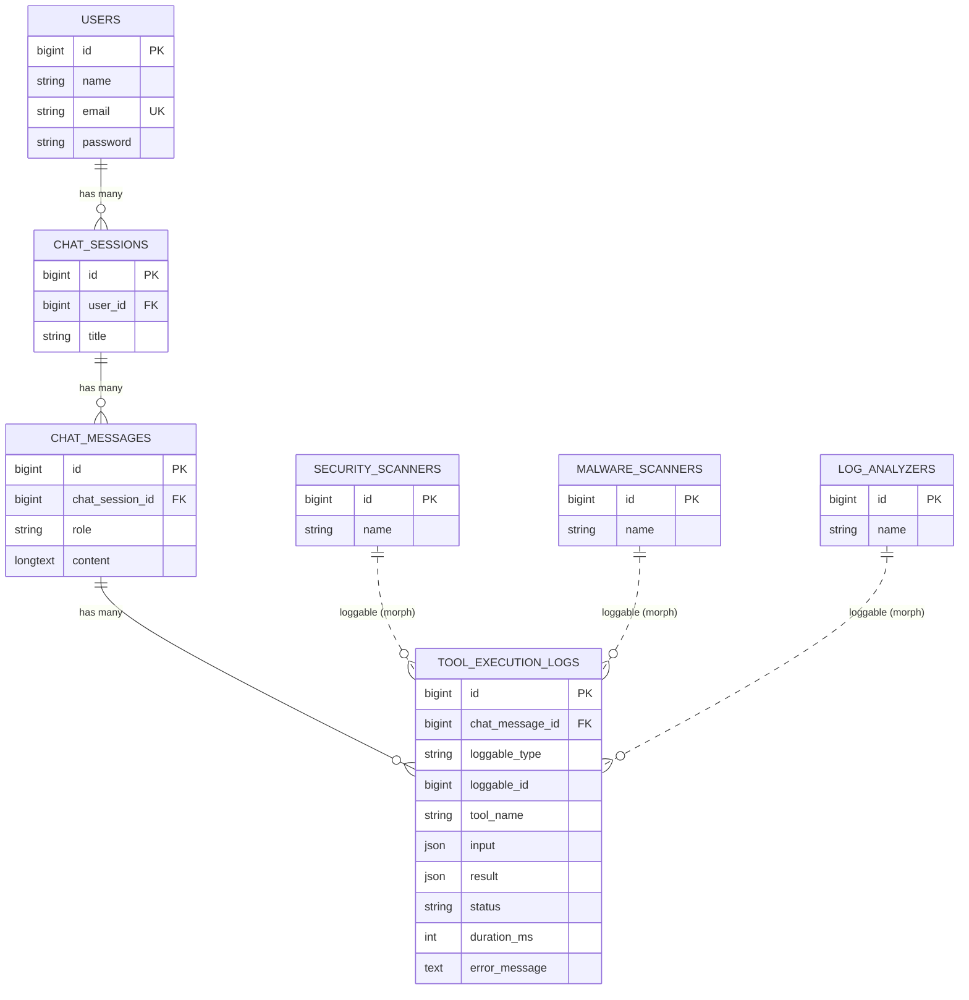
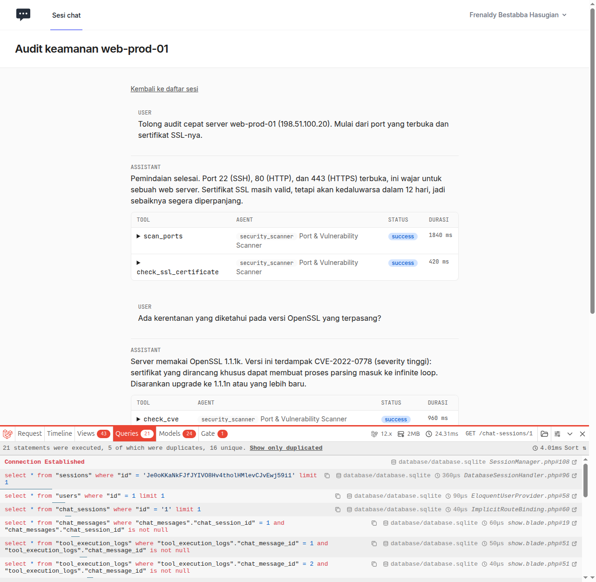
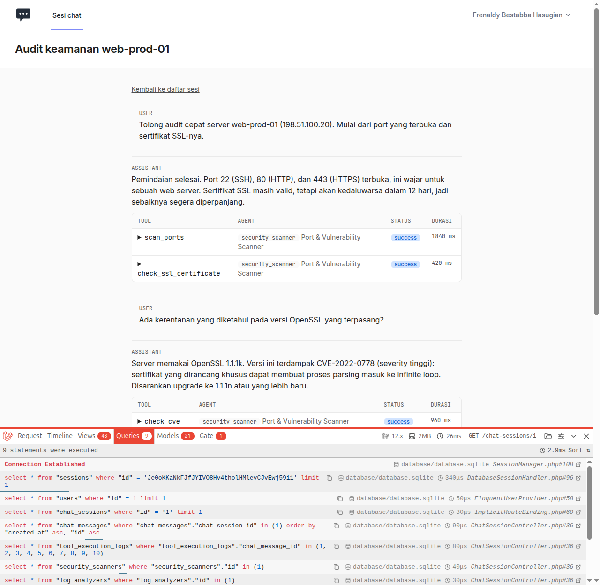

# AgentChat — Tugas 9 PBKK: Pemodelan Relasi Agentic AI Platform

Fondasi basis data relasional untuk platform agent AI **Kelompok 1**: sesi obrolan, isi pesan, dan log pemanggilan
tool oleh agent. Dibuat dengan Laravel 12 (Eloquent + migration) dan Breeze (Blade).

## Konteks tugas

Tugas Pertemuan 9 mata kuliah PBKK melatih pemodelan skema database relasional dunia nyata, sebagai pondasi proyek
kelompok Platform Agentic AI. Ketentuannya:

- **Empat model wajib:** `User` (bawaan Breeze), `ChatSession`, `ChatMessage`, `ToolExecutionLog`.
- **Relasi:** `User` hasMany `ChatSession`; `ChatSession` belongsTo `User` dan hasMany `ChatMessage`;
  `ChatMessage` belongsTo `ChatSession` dan hasMany `ToolExecutionLog`; `ToolExecutionLog` belongsTo `ChatMessage`.
- **Migrasi** lengkap dengan foreign key dan `onDelete('cascade')`, serta **factory** untuk data dummy relasional.
- **Challenge 1:** `ToolExecutionLog` dibuat polymorphic (`morphs('loggable')`) agar bisa dirujuk berbagai tipe agent
  (`SecurityScanner`, `MalwareScanner`, `LogAnalyzer`).
- **Challenge 2:** kueri riwayat obrolan dengan eager loading bertingkat, bebas N+1, dibuktikan dengan screenshot
  Laravel Debugbar.
- **ERD** di `README.md` ini.

Soal lengkap ada di [`notes/tugas.txt`](notes/tugas.txt); rancangan, desain tampilan, dan tech stack ada di [`notes/`](notes/).

## Anggota Kelompok 1

| Nama                             | NRP        |
| -------------------------------- | ---------- |
| Mitra Partogi                    | 5025241017 |
| Dimas Setiaji                    | 5025241056 |
| Steven Alvin Christian           | 5025241116 |
| Frenaldy Bestabba Hasugian       | 5025241156 |
| Hoshida Ahmad Tsalatsu Fadlulloh | 5025241174 |
| Isabella Sienna Sulisthio        | 5025241199 |

## Cara menjalankan

```bash
composer install
npm install && npm run build
cp .env.example .env && php artisan key:generate
touch database/database.sqlite        # DB_CONNECTION=sqlite (default)
php artisan migrate:fresh --seed
php artisan serve
```

Akun demo, satu per anggota (password semuanya `password`):

| Email | Nama | Sesi |
|---|---|---|
| `frenaldy@example.com` | Frenaldy Bestabba Hasugian | 3 sesi, termasuk `Audit keamanan web-prod-01` |
| `mitra@example.com` | Mitra Partogi | 1 sesi |
| `dimas@example.com` | Dimas Setiaji | 1 sesi |
| `steven@example.com` | Steven Alvin Christian | belum ada sesi |
| `hoshida@example.com` | Hoshida Ahmad Tsalatsu Fadlulloh | belum ada sesi |
| `isabella@example.com` | Isabella Sienna Sulisthio | belum ada sesi |

Akun baru bisa dibuat lewat tautan **Register** di halaman login (`/register`). Akun baru mulai tanpa sesi.

Sesi `Audit keamanan web-prod-01` berisi data tetap (10 pesan, 6 tool log dari 3 tipe agent) untuk perbandingan Debugbar.
Percakapan ditulis tangan di `database/seeders/ChatScenarios.php`; baris datanya tetap dibuat lewat factory.

```bash
php artisan test               # PHPUnit
vendor/bin/pint --test         # cek PSR-12
```

## ERD



Garis putus-putus = relasi polymorphic (tanpa foreign key di database).

## Relasi

| Model | Method | Tipe |
|---|---|---|
| `User` | `chatSessions()` | `hasMany` |
| `ChatSession` | `user()` / `messages()` | `belongsTo` / `hasMany` |
| `ChatMessage` | `chatSession()` / `toolExecutionLogs()` | `belongsTo` / `hasMany` |
| `ToolExecutionLog` | `chatMessage()` / `loggable()` | `belongsTo` / `morphTo` |
| `SecurityScanner`, `MalwareScanner`, `LogAnalyzer` | `toolExecutionLogs()` | `morphMany` (trait `HasToolExecutionLogs`) |

Semua foreign key memakai `constrained()->cascadeOnDelete()`; menghapus user menghapus sesi, pesan, dan log turunannya.
Setiap kolom foreign key juga ber-index: `(user_id, updated_at)`, `(chat_session_id, created_at)`, dan `chat_message_id`.
Index ini ditulis eksplisit karena SQLite dan PostgreSQL, berbeda dengan MySQL, tidak membuatnya otomatis untuk kolom FK.

## Challenge 1: Polymorphic logging

`tool_execution_logs` memakai `morphs('loggable')`, sehingga satu tabel log bisa dirujuk oleh tiga tipe agent. Relasi
`chat_message_id` tetap dipertahankan. `Relation::enforceMorphMap()` menyimpan alias pendek (`security_scanner`,
`malware_scanner`, `log_analyzer`) di kolom `loggable_type`, bukan nama class lengkap.

> **Trade-off:** kolom morph tidak bisa punya foreign key di level database. Integritasnya dijaga di aplikasi:
> morph map menolak tipe liar, dan trait `HasToolExecutionLogs` menghapus log milik agent saat agent dihapus lewat
> model (`$agent->delete()`). Penghapusan massal (`SecurityScanner::query()->delete()`) tidak memicu event model, jadi
> log bisa tertinggal; halaman riwayat tetap tampil dan menandai agent-nya sebagai "(agent sudah dihapus)".

## Challenge 2: Eager loading bertingkat (bebas N+1)

`ChatSessionController@show` memuat seluruh riwayat dengan satu query per level relasi:

```php
$chatSession->load([
    'messages' => fn ($query) => $query->orderBy('created_at')->orderBy('id'),
    'messages.toolExecutionLogs.loggable',
]);
```

Bukti dengan sesi demo yang sama (10 pesan, 6 log), diambil dari Laravel Debugbar:

| | Query | Keterangan |
|---|---|---|
| Sebelum (tanpa `load()`) | **21** (5 duplikat) | 1 pesan + 10 log (per pesan) + 6 agent (per log) + 4 lainnya |
| Sesudah (eager loading) | **9** | pesan, log, dan agent masing-masing 1 query per level |

**Sebelum:** satu query `tool_execution_logs` untuk setiap pesan (`chat_message_id = 1`, `= 2`, ...).



**Sesudah:** satu query `tool_execution_logs ... in (1, 2, ..., 10)` untuk semua pesan sekaligus.



Dari 9 query "sesudah", 3 milik framework (baca sesi, baca user, update sesi) dan 6 milik aplikasi: sesi (route binding),
pesan, log, dan satu query per tipe agent (maksimal 3). Angka ini **tidak naik** bila pesan atau log bertambah.

Tiga lapis pembuktian:
1. Screenshot Debugbar di atas.
2. `Model::preventLazyLoading()` di `AppServiceProvider`: di lingkungan dev, lazy load pada model yang dimuat sebagai
   koleksi (sumber N+1, mis. log per pesan) langsung melempar `LazyLoadingViolationException`. Laravel sengaja
   membebaskan model tunggal, karena satu model tidak bisa menimbulkan N+1.
3. `ChatHistoryQueryTest`: sesi 2 pesan dan sesi 20 pesan menghasilkan jumlah query yang sama.

## Pemetaan rubrik

| Kriteria (bobot) | Bukti | Lokasi |
|---|---|---|
| Rancangan skema & migrasi (35%) | FK + `cascadeOnDelete()` + index pada setiap kolom FK | `database/migrations/*`, `CascadeTest` |
| Model & ORM (25%) | `hasMany`/`belongsTo`, `$fillable`, casts, enum | `app/Models/*`, `RelationsTest` |
| Eager loading (20%) | `load()` bertingkat, jumlah query konstan | `ChatSessionController`, `ChatHistoryQueryTest` |
| Challenge A+ (10%) | `morphs('loggable')` + 3 agent + morph map | migrasi `tool_execution_logs`, `PolymorphicLogTest` |
| PSR-12 (10%) | Pint preset `psr12` bersih | `pint.json`, `vendor/bin/pint --test` |
