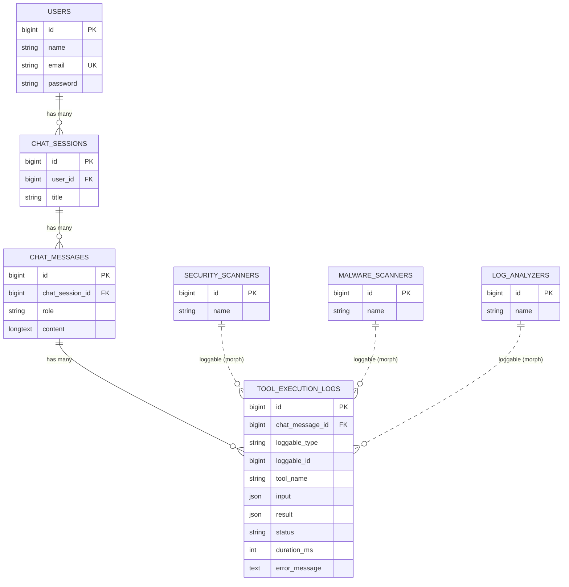

# Tugas 9: Pemodelan Relasi Agentic AI Platform

Fondasi basis data relasional untuk platform agent AI: sesi obrolan, isi pesan, dan log pemanggilan tool.
Dibuat dengan Laravel 12 (Eloquent + migration) dan Breeze (Blade). Rancangan lengkap ada di folder [`notes/`](notes/).

## Cara menjalankan

```bash
composer install
npm install && npm run build
cp .env.example .env && php artisan key:generate
touch database/database.sqlite        # DB_CONNECTION=sqlite (default)
php artisan migrate:fresh --seed
php artisan serve
```

Login demo: `test@example.com` / `password`. Buka menu **Sesi chat**; sesi `Demo: 10 messages, 6 tool logs`
berisi data tetap (10 pesan, 6 log) untuk perbandingan Debugbar.

```bash
php artisan test               # PHPUnit
vendor/bin/pint --test         # cek PSR-12
```

## ERD



Garis putus-putus = relasi polymorphic (tanpa foreign key di database).

## Relasi

| Model | Method | Tipe |
|---|---|---|
| `User` | `chatSessions()` | `hasMany` |
| `ChatSession` | `user()` / `messages()` | `belongsTo` / `hasMany` |
| `ChatMessage` | `chatSession()` / `toolExecutionLogs()` | `belongsTo` / `hasMany` |
| `ToolExecutionLog` | `chatMessage()` / `loggable()` | `belongsTo` / `morphTo` |
| `SecurityScanner`, `MalwareScanner`, `LogAnalyzer` | `toolExecutionLogs()` | `morphMany` (trait `HasToolExecutionLogs`) |

Semua foreign key memakai `constrained()->cascadeOnDelete()`; menghapus user menghapus sesi, pesan, dan log turunannya.

## Challenge 1: Polymorphic logging

`tool_execution_logs` memakai `morphs('loggable')`, sehingga satu tabel log bisa dirujuk oleh tiga tipe agent. Relasi
`chat_message_id` tetap dipertahankan. `Relation::enforceMorphMap()` menyimpan alias pendek (`security_scanner`,
`malware_scanner`, `log_analyzer`) di kolom `loggable_type`, bukan nama class lengkap.

> **Trade-off:** kolom morph tidak bisa punya foreign key di level database. Integritasnya dijaga di aplikasi:
> morph map menolak tipe liar, dan trait `HasToolExecutionLogs` menghapus log saat agent dihapus.

## Challenge 2: Eager loading bertingkat (bebas N+1)

`ChatSessionController@show` memuat seluruh riwayat dengan satu query per level relasi:

```php
$chatSession->load([
    'messages' => fn ($query) => $query->orderBy('created_at')->orderBy('id'),
    'messages.toolExecutionLogs.loggable',
]);
```

Bukti dengan sesi demo yang sama (10 pesan, 6 log), diambil dari Laravel Debugbar:

| | Query | Keterangan | Screenshot |
|---|---|---|---|
| Sebelum (tanpa `load()`) | **21** (5 duplikat) | 1 pesan + 10 log (per pesan) + 6 agent (per log) + 4 lainnya | [debugbar-sebelum.png](docs/screenshots/debugbar-sebelum.png) |
| Sesudah (eager loading) | **9** | pesan, log, dan agent masing-masing 1 query per level | [debugbar-sesudah.png](docs/screenshots/debugbar-sesudah.png) |

Dari 9 query "sesudah", 3 milik framework (baca sesi, baca user, update sesi) dan 6 milik aplikasi: sesi (route binding),
pesan, log, dan satu query per tipe agent (maksimal 3). Angka ini **tidak naik** bila pesan atau log bertambah.

Tiga lapis pembuktian:
1. Screenshot Debugbar di atas.
2. `Model::preventLazyLoading()` di `AppServiceProvider`: lazy load yang tersisa langsung error di lingkungan dev.
3. `ChatHistoryQueryTest`: sesi 2 pesan dan sesi 20 pesan menghasilkan jumlah query yang sama.

## Pemetaan rubrik

| Kriteria (bobot) | Bukti | Lokasi |
|---|---|---|
| Rancangan skema & migrasi (35%) | FK + `cascadeOnDelete()` + index | `database/migrations/*`, `CascadeTest` |
| Model & ORM (25%) | `hasMany`/`belongsTo`, `$fillable`, casts, enum | `app/Models/*`, `RelationsTest` |
| Eager loading (20%) | `load()` bertingkat, jumlah query konstan | `ChatSessionController`, `ChatHistoryQueryTest` |
| Challenge A+ (10%) | `morphs('loggable')` + 3 agent + morph map | migrasi `tool_execution_logs`, `PolymorphicLogTest` |
| PSR-12 (10%) | Pint preset `psr12` bersih | `pint.json`, `vendor/bin/pint --test` |
