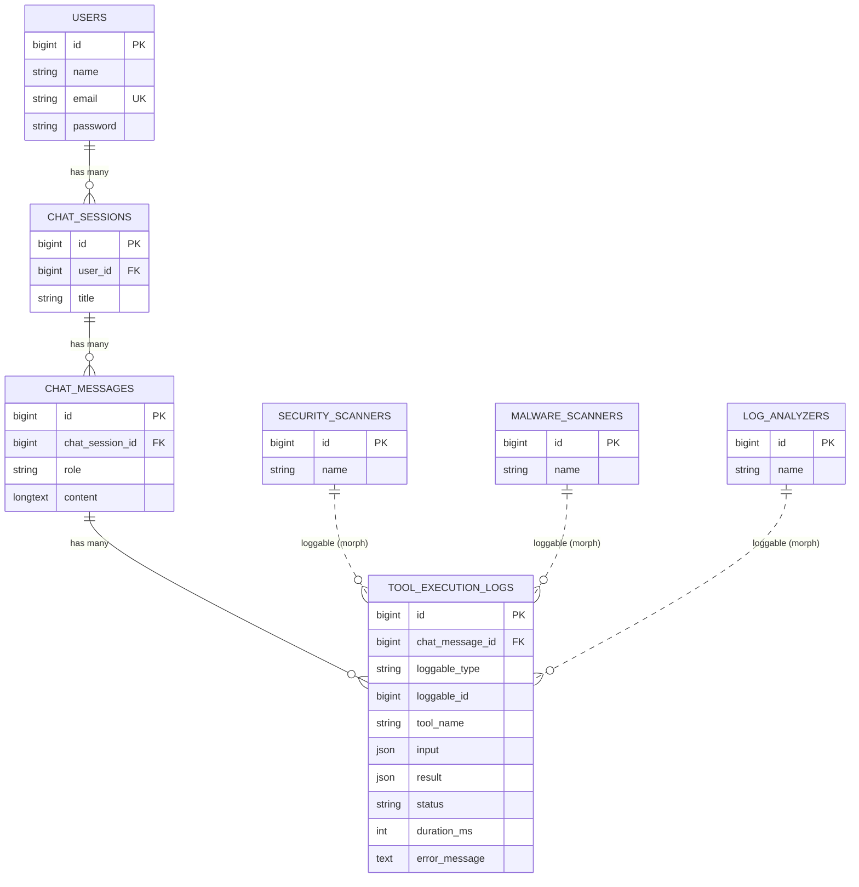

# Rencana Tugas 9: Pemodelan Relasi Agentic AI Platform

## 1. Tujuan
Membangun fondasi basis data relasional untuk fitur obrolan agent AI: sesi chat, isi pesan, dan log pemanggilan
tool. Dikerjakan di Laravel (Eloquent + migration), lengkap dengan FK, cascade, factory, ERD, dan bukti bebas N+1.

**Dasar rencana:** `notes/tugas.txt`. Rubrik: Skema & Migrasi 35%, Model & ORM 25%, Eager Loading 20%, Challenge A+ 10%,
PSR-12 10%.
**Dokumen pendamping:** `DESIGN.md` (tampilan) dan `TECHSTACK.md` (tech stack + struktur folder).

## 2. Keputusan desain (dan alasannya)
| Keputusan | Pilihan | Alasan |
|---|---|---|
| Lokasi proyek | Proyek Laravel baru di `tugas-9/`, lalu dihubungkan ke repo kelompok | Tugas minta repo GitHub kelompok yang sama dengan minggu lalu; repo itu belum ada di disk ini, jadi hubungkan setelah jadi (Langkah 0) |
| Versi | Laravel ^12, PHP ^8.2, Breeze (Blade), PHPUnit | Sama dengan tugas-4/tugas-6, jadi pola dan tooling sudah dikenal |
| Database dev | SQLite (default Laravel), migrasi ditulis portabel | Tanpa setup; ganti ke MySQL lewat `.env` bila repo kelompok memakai MySQL. Hindari fitur khusus satu DB |
| Polymorphic | **Pertahankan** `chat_message_id` **dan tambah** `morphs('loggable')` | Relasi `hasMany`/`belongsTo` yang diminta rubrik (60%) tetap utuh; `loggable` = agent yang menjalankan tool |
| `role` & `status` | Kolom `string` + PHP backed enum cast | Lebih portabel dibanding `enum` DB, dan tetap tervalidasi di level aplikasi |
| Nama morph di DB | `Relation::enforceMorphMap()` (alias pendek) | `loggable_type` berisi `security_scanner`, bukan nama class lengkap, jadi tidak rusak bila namespace berubah |

## 3. Skema database
Urutan migrasi (menurut timestamp nama file): `users` (bawaan) → `chat_sessions` → `chat_messages` →
`security_scanners`, `malware_scanners`, `log_analyzers` → `tool_execution_logs`.

**`users`** — bawaan Breeze, tidak diubah.

**`chat_sessions`**
| Kolom | Tipe | Catatan |
|---|---|---|
| id | bigint PK | |
| user_id | foreignId | `constrained()->cascadeOnDelete()` |
| title | string(150) nullable | judul sesi |
| timestamps | | |
| index | (user_id, updated_at) | daftar sesi terbaru milik user |

**`chat_messages`**
| Kolom | Tipe | Catatan |
|---|---|---|
| id | bigint PK | |
| chat_session_id | foreignId | `constrained()->cascadeOnDelete()` |
| role | string(20) | `user` / `assistant` / `system` / `tool` (enum `MessageRole`) |
| content | longText | isi percakapan |
| timestamps | | |
| index | (chat_session_id, created_at) | urutan pesan dalam sesi |

**`tool_execution_logs`**
| Kolom | Tipe | Catatan |
|---|---|---|
| id | bigint PK | |
| chat_message_id | foreignId | `constrained()->cascadeOnDelete()` |
| loggable_type, loggable_id | `morphs('loggable')` | **Challenge 1**; membuat kolom type+id dan index gabungan |
| tool_name | string(100) | mis. `search_files` |
| input | json nullable | argumen pemanggilan |
| result | json nullable | hasil eksekusi |
| status | string(20) default `pending` | `pending` / `success` / `failed` (enum `ToolStatus`) |
| duration_ms | unsignedInteger nullable | |
| error_message | text nullable | |
| timestamps | | |

**Tabel agent (target polymorphic):** `security_scanners`, `malware_scanners`, `log_analyzers`, masing-masing
`id`, `name`, `timestamps`. Dibuat minimal; fungsinya hanya menjadi tipe `loggable` yang berbeda.

> **Batasan polymorphic:** kolom morph tidak bisa punya FK di level database. Integritas `loggable` dijaga di aplikasi:
> `enforceMorphMap` mencegah tipe liar, dan trait agent menghapus lognya saat agent dihapus (lihat Bagian 4).

## 4. Relasi & model
| Model | Method relasi | Tipe |
|---|---|---|
| `User` | `chatSessions()` | `HasMany` |
| `ChatSession` | `user()` | `BelongsTo` |
| | `messages()` | `HasMany` |
| `ChatMessage` | `chatSession()` | `BelongsTo` |
| | `toolExecutionLogs()` | `HasMany` |
| `ToolExecutionLog` | `chatMessage()` | `BelongsTo` |
| | `loggable()` | `MorphTo` |
| `SecurityScanner`, `MalwareScanner`, `LogAnalyzer` | `toolExecutionLogs()` | `MorphMany` (lewat trait `HasToolExecutionLogs`) |

Aturan penulisan: nama method plural untuk `hasMany`, singular untuk `belongsTo`; semua punya return type; setiap
model mendefinisikan `$fillable` (proteksi mass assignment); `input`/`result` di-cast `array`; `role`/`status` di-cast ke enum.

`HasToolExecutionLogs` (satu trait dipakai tiga agent, bukan menulis ulang tiga kali):
```php
trait HasToolExecutionLogs
{
    // Logs written by this agent, via the loggable_type/loggable_id pair
    public function toolExecutionLogs(): MorphMany
    {
        return $this->morphMany(ToolExecutionLog::class, 'loggable');
    }

    // The DB cannot cascade on a morph column, so clean up here
    protected static function bootHasToolExecutionLogs(): void
    {
        static::deleting(fn ($agent) => $agent->toolExecutionLogs()->delete());
    }
}
```

## 4b. ERD (untuk `README.md`, GitHub merender Mermaid langsung)

Garis putus-putus = relasi polymorphic (tanpa FK database).

## 5. Factory & seeder
- `ChatSessionFactory`, `ChatMessageFactory`, `ToolExecutionLogFactory`, plus factory untuk 3 agent.
  `UserFactory` bawaan dipakai ulang.
- `ToolExecutionLogFactory` memilih `loggable` acak dari 3 tipe agent, supaya data dummy memuat ketiga tipe.
- `DatabaseSeeder`: 5 user × 3 sesi × ±8 pesan (bergantian `user`/`assistant`), pesan `assistant` punya 0–2 log.
- Tambah **1 sesi demo dengan jumlah tetap** (mis. 10 pesan, 6 log) supaya screenshot Debugbar "sebelum vs sesudah"
  bisa dibandingkan apel dengan apel.

## 6. Challenge 2: kueri riwayat obrolan bebas N+1
Route (di dalam grup `auth` bawaan Breeze): `GET /chat-sessions` (daftar) dan `GET /chat-sessions/{chatSession}` (detail).
```php
public function show(ChatSession $chatSession): View
{
    // Only the owner may open a session (ChatSessionPolicy@view compares user_id)
    $this->authorize('view', $chatSession);

    // Nested eager loading: one query per level, not one per row
    $chatSession->load([
        'messages' => fn ($query) => $query->orderBy('created_at'),
        'messages.toolExecutionLogs.loggable',
    ]);

    return view('chat-sessions.show', compact('chatSession'));
}
```
**Jumlah query yang diharapkan:** sesi (route binding) + user login + pesan + log + `loggable` (satu per tipe agent yang
muncul, maksimal 3) = **paling banyak 7, dan angkanya tidak naik bila pesan atau log bertambah**. Itulah arti "bebas N+1":
jumlah query bergantung pada jumlah *level relasi*, bukan jumlah baris.

**Bukti (tiga lapis):**
1. Screenshot Laravel Debugbar tab Queries: *sebelum* (matikan `load()` sementara, jangan di-commit) dan *sesudah*.
2. `Model::preventLazyLoading(! app()->isProduction())` di `AppServiceProvider::boot()`: bila ada lazy load tersisa,
   halaman langsung error di lingkungan dev.
3. Feature test yang membandingkan jumlah query untuk sesi 2 pesan vs sesi 20 pesan; keduanya harus sama.

Halaman `resources/views/chat-sessions/show.blade.php` memakai `<x-app-layout>` bawaan Breeze (perlu halaman HTML
agar Debugbar tampil). Debugbar hanya untuk dev: `composer require barryvdh/laravel-debugbar --dev`.

## 7. Langkah implementasi (urut)
**Langkah 0: Siapkan proyek.** `tugas-9/` sudah berisi `notes/`, dan `create-project` butuh folder kosong, jadi buat
di folder sementara lalu salin tanpa menimpa `notes/`:
```bash
composer create-project laravel/laravel:^12.0 /tmp/tugas-9-scaffold
rsync -a --ignore-existing /tmp/tugas-9-scaffold/ tugas-9/ && git -C tugas-9 init
```
Setelah jadi: hubungkan ke repo kelompok (`git remote add origin ...`) atau salin hasilnya ke repo tersebut.

**Langkah 1: Auth & tooling.** `composer require laravel/breeze --dev` → `php artisan breeze:install blade` →
`npm install && npm run build`; `composer require barryvdh/laravel-debugbar --dev`; salin `pint.json`
(`{"preset": "psr12"}`) dari `tugas-6/pint.json`.

**Langkah 2: Migrasi & model.** `php artisan make:model ChatSession -mf`, lalu `ChatMessage`, tiga agent, dan
`ToolExecutionLog` (urutan dibuat = urutan timestamp). Tulis kolom, FK, cascade, index sesuai Bagian 3.

**Langkah 3: Relasi.** Isi method relasi, `$fillable`, `casts()`, trait agent, dan `Relation::enforceMorphMap()` di
`AppServiceProvider`. Buat enum `MessageRole` dan `ToolStatus` di `app/Enums/`.

**Langkah 4: Data dummy.** Factory + seeder (Bagian 5), lalu `php artisan migrate:fresh --seed`.

**Langkah 5: Controller, policy, view.** `ChatSessionController`, `ChatSessionPolicy`, route, view (Bagian 6).
Tampilan mengikuti `DESIGN.md`; font dan konfigurasi Tailwind mengikuti `TECHSTACK.md`.

**Langkah 6: Test (PHPUnit).**
- `RelationsTest`: tiap method relasi mengembalikan tipe yang benar dan data yang benar.
- `CascadeTest`: hapus user → `chat_sessions`, `chat_messages`, `tool_execution_logs` miliknya ikut hilang;
  menyisipkan pesan dengan `chat_session_id` yang tidak ada → `QueryException` (membuktikan FK aktif, termasuk di SQLite).
- `PolymorphicLogTest`: `loggable` me-resolve ke class yang benar untuk ketiga tipe; kolom berisi alias pendek;
  hapus agent → lognya ikut terhapus.
- `ChatHistoryQueryTest`: jumlah query tidak bergantung ukuran data; user lain mendapat 403.

**Langkah 7: README.** Judul, cara menjalankan, ERD Mermaid (Bagian 4b), screenshot Debugbar sebelum/sesudah,
tabel pemetaan rubrik.

**Langkah 8: Kerapian.** `vendor/bin/pint` lalu `vendor/bin/pint --test` (harus bersih); `php artisan test` hijau.

**Langkah 9: Kumpulkan.** Push ke repo kelompok, kirim tautan ke LMS ITS.

## 8. Pitch: 5 slide, maksimal 5 menit
| # | Slide | Isi | Waktu |
|---|---|---|---|
| 1 | Masalah & tujuan | Mengapa agent AI butuh sesi, pesan, dan log tool yang terstruktur | 0:40 |
| 2 | ERD | Diagram dari Bagian 4b; sebut 4 relasi dan 1 relasi polymorphic | 1:00 |
| 3 | Migrasi & integritas | FK + `cascade`; demo hapus user → semua turunannya ikut hilang | 1:00 |
| 4 | Challenge | Polymorphic `loggable` (3 tipe agent) dan eager loading: screenshot Debugbar sebelum vs sesudah | 1:30 |
| 5 | Penutup | Pemetaan rubrik, hasil test, tautan repo | 0:50 |

Total 5:00, tanpa cadangan waktu; **latih sampai ≤ 4:30**, karena durasi dibatasi ketat. Gaya visual boleh memakai ulang
template deck FP (navy `#101B40`, Montserrat) supaya konsisten.

## 9. Pemetaan rubrik
| Kriteria (bobot) | Bukti | Lokasi |
|---|---|---|
| Rancangan Skema & Migrasi (35%) | FK benar + `cascadeOnDelete()` + index; migrasi urut | `database/migrations/*`; `CascadeTest` |
| Model & ORM (25%) | `hasMany`/`belongsTo` bernama sesuai konvensi, `$fillable`, casts | `app/Models/*`; `RelationsTest` |
| Eager Loading (20%) | `load()` bertingkat; jumlah query konstan | `ChatSessionController@show`; `ChatHistoryQueryTest`; screenshot Debugbar |
| Challenge A+ (10%) | `morphs('loggable')` + 3 tipe agent + morph map | migrasi `tool_execution_logs`; `PolymorphicLogTest` |
| PSR-12 (10%) | Pint preset `psr12` bersih | `pint.json`; `vendor/bin/pint --test` |

## 10. Risiko & trade-off
- **Polymorphic tanpa FK DB.** Konsekuensi dari desain Laravel, bukan kekurangan implementasi. Dijaga lewat morph map
  dan hook `deleting` di trait. Sebutkan ini saat demo sebagai trade-off yang disadari.
- **`morphs()` non-nullable.** Artinya setiap log wajib punya agent. Itu sesuai maksud tugas (log aktivitas agent);
  bila nanti ada tool tanpa agent, ganti ke `nullableMorphs()`.
- **`morphTo` + eager loading.** Satu query tambahan per tipe `loggable` yang muncul. Tetap bukan N+1, tetapi karena
  itu batas atasnya 7 query, bukan 3.
- **Repo kelompok.** Tugas mewajibkan repo yang sama dengan minggu lalu. Jangan lupa Langkah 0 (hubungkan atau salin).
- **Tanggal.** Batas kumpul = **H-1 sebelum Pertemuan 10**; tanggal Pertemuan 10 belum diketahui: `____` (isi).
- **Urutan tampil diacak** di awal Pertemuan 10; siapkan slide dan demo di perangkat yang sama.

## 11. Checklist akhir
- [ ] 4 model + 3 model agent, migrasi berjalan dari nol (`migrate:fresh --seed`)
- [ ] FK + cascade terbukti oleh test
- [ ] `ToolExecutionLog` polymorphic (`morphs('loggable')`) dan relasi ke `ChatMessage` tetap ada
- [ ] Controller memakai eager loading bertingkat; screenshot Debugbar sebelum/sesudah ada di README
- [ ] ERD di `README.md`
- [ ] `pint --test` bersih, `php artisan test` hijau
- [ ] Slide ≤ 5 halaman, latihan ≤ 5 menit
- [ ] Tautan repo terkirim ke LMS ITS sebelum H-1 Pertemuan 10
